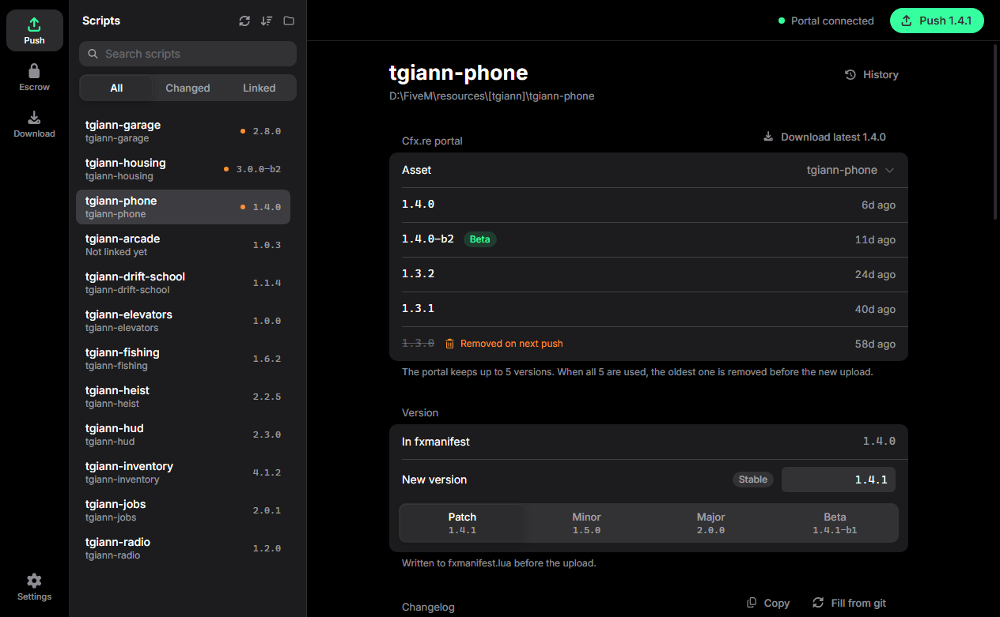
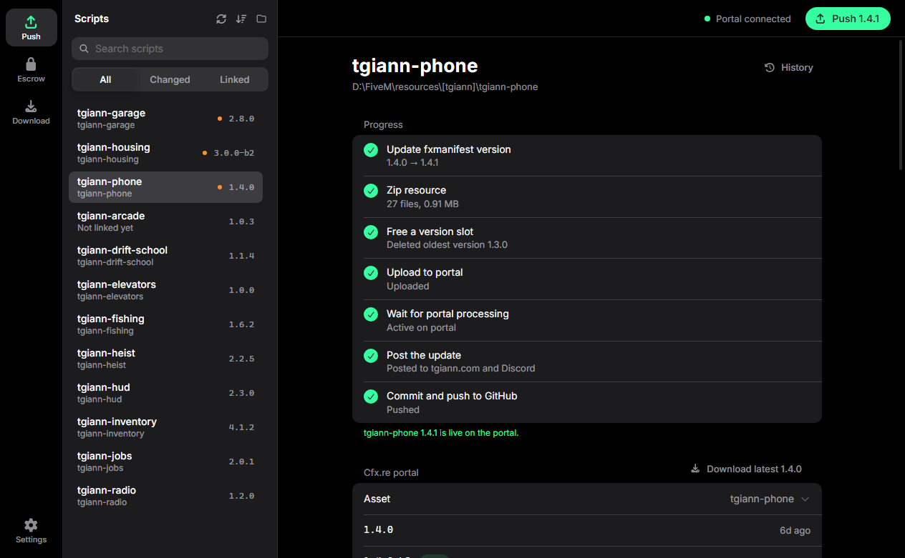
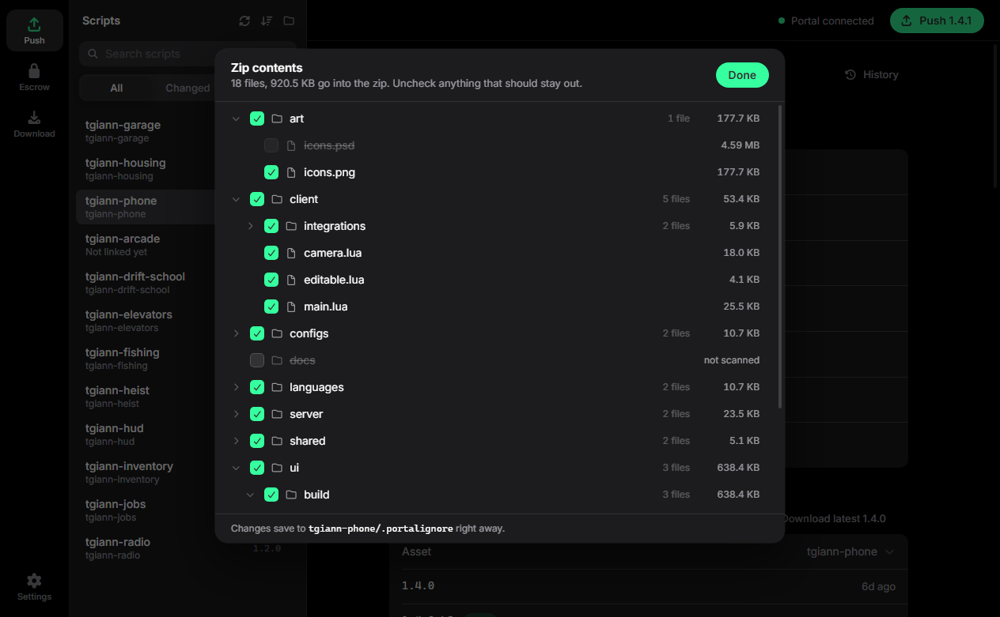
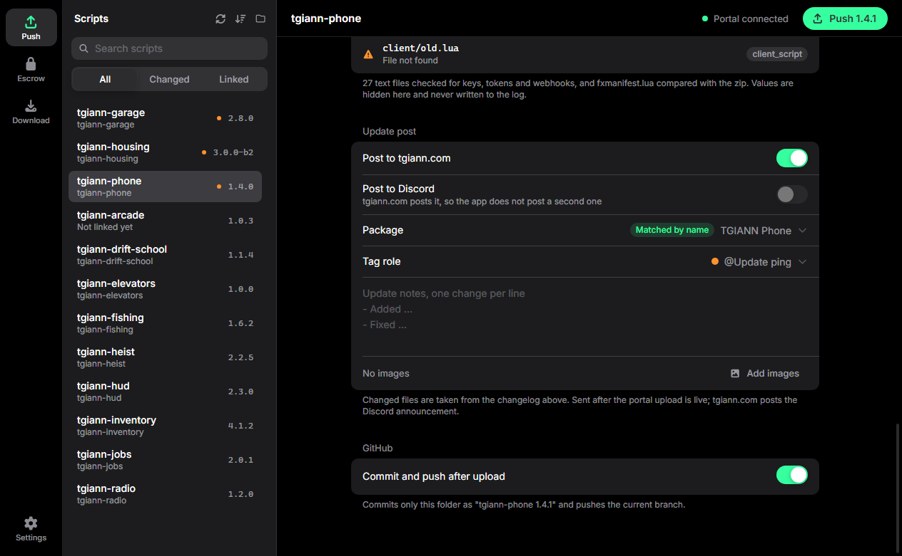
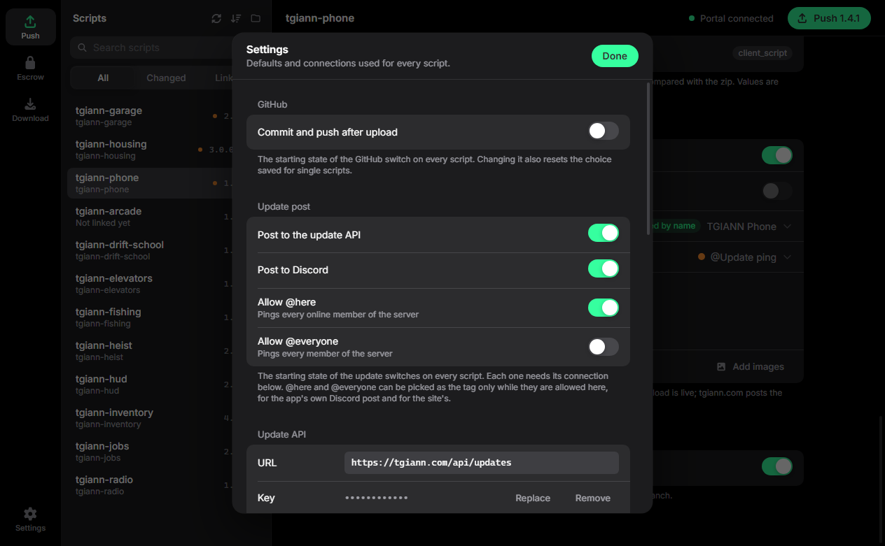
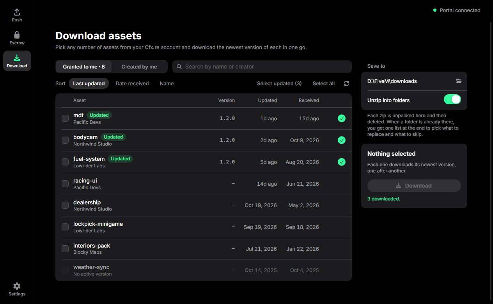
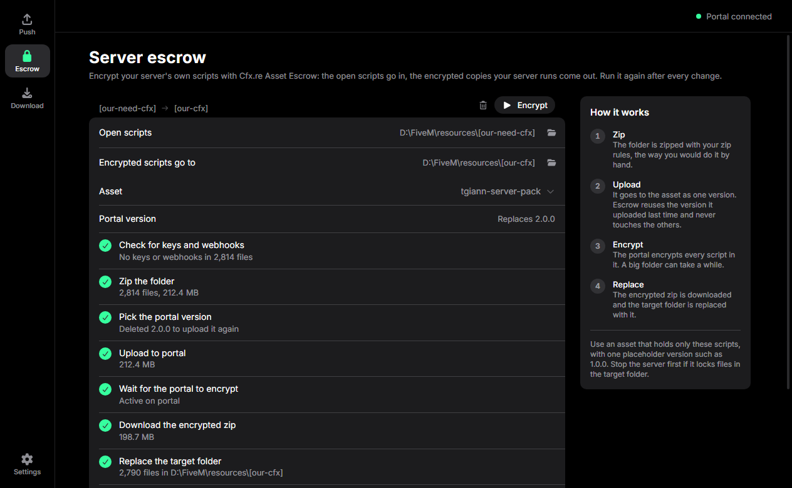

<p align="center">
  
</p>

<p align="center">
  A Windows desktop app that turns "update the script on the Cfx.re Portal" into one button.<br>
  It bumps the version in <code>fxmanifest.lua</code>, zips the resource, uploads it as a new portal version, posts the update notes to your site or Discord, and can commit and push the folder to GitHub.<br>
  It also downloads portal versions, many assets at once, and runs a whole server folder through the portal's encryption into another folder.
</p>

> [!NOTE]
> **This project was built with AI.** The code, the design, this README and the diagrams were written by Claude (Anthropic's AI model) inside [Claude Code](https://claude.com/claude-code), driven step by step by a human maintainer who set the requirements, tested every build against the real Cfx.re Portal and reported back what broke. Treat it like any other community tool: read the code before you trust it with your account.

> [!WARNING]
> Cfx.re does not offer a public API for the Portal. This app talks to the same endpoints the portal website uses, so a change on their side can break it at any time. It is not affiliated with or endorsed by Cfx.re, Rockstar Games or Tebex.

<p align="center">
  
</p>

## Why

Shipping an update to a paid FiveM resource used to look like this: open `fxmanifest.lua` and guess the next version, check what is already on the portal, zip the folder by hand (without `.git`, `node_modules` and the files you forgot about), delete an old version because the portal only keeps five, upload, write a changelog from memory, then remember to commit. FiveM Portal Push does all of that from one screen.

## Features

The bar on the left has three pages: **Push** uploads one script at a time, **Escrow** runs a whole server folder through Asset Escrow, and **Download** gets many assets from your account at once.

- **Every script in one list.** Point it at your `resources` folders; every folder with an `fxmanifest.lua` shows up, with scripts that have uncommitted changes on top. Search, filter and sort by name, version or last push.
- **Knows what is live.** Shows the versions already on the portal next to the one in `fxmanifest.lua` and suggests the next version, so you never upload the same number twice.
- **Replace a version.** Fixed something right after a push? Turn on **Replace** to delete that portal version and upload the folder again under the same number.
- **Beta releases.** A version ending in `-b1`, `-b2`, `-beta1` or `-rc1` is uploaded as a release candidate.
- **Handles the 5 version limit.** When the asset already has five versions, the oldest one is removed before the upload. The list shows which one beforehand.
- **Changelog from git.** Prefilled with the files that changed since your last push. The portal renders release notes as Markdown, so the list goes inside a code block to keep one file per line:
  ```
  modified:   client/main.lua
  modified:   fxmanifest.lua
  +new:       client/integrations/
  -deleted:   server/old.lua
  modified:   ui/build (delete the 'ui/build' folder before updating the 'ui/build' folder)
  ```
  Which folders count as one line (`ui/build`, `web/app` and so on) is set in Settings, Build folders.
- **Zip rules you can see.** Browse the resource as a tree and untick whatever should stay out of the zip. Rules are saved in a `.portalignore` file inside the resource, so they travel with git to every PC. Rules for all scripts live in the app.
- **Checks before the upload.** Every text file going into the zip is scanned for Discord webhooks and bot tokens, Steam, Cfx, GitHub, AWS, Google, AI and Stripe keys, private keys and database passwords. A sure match blocks the push until you remove the value, exclude the file or allow that one finding. Values are masked on screen and never logged. `fxmanifest.lua` is compared with the zip too, so a missing file, a wrong upper or lower case or a file your zip rules drop shows as a warning.
- **More than one folder in a zip.** Add other resources (a shared library, a bridge) or loose files like install notes to the same upload. They sit next to the script folder at the zip root.
- **Remembers the portal asset.** Pick the matching portal asset once (exact name matches are linked automatically) and it is selected for you next time.
- **Update post.** After the upload is live, post the update notes, changed files, package name, a role tag and images to your own site and/or Discord (webhook or bot). The package and role are saved for each script.
- **Download any version.** Every active version of the linked asset has a download button, and **Download latest** saves the newest one. You get the encrypted zip the portal serves.
- **Download many assets at once.** The **Download** page lists the assets granted to you and the ones you created. Tick as many as you like, or **Select updated** for the ones that changed since your last download, and they download one after another into one folder. Turn on **Unzip into folders** to get folders instead of zips. See [Download assets](#download-assets).
- **Escrow a whole server folder.** The **Escrow** page zips a folder of open scripts (for example `[our-need-cfx]`), uploads it to one portal asset, picks the version number itself, waits until the portal has encrypted it, downloads the result and replaces another folder (for example `[our-cfx]`) with it. One click instead of zipping, deleting the old version, uploading, downloading and unpacking by hand. See [Server escrow](#server-escrow).
- **Updates itself.** The installed app finds new releases on GitHub, shows the notes and installs them. The portable exe links to the download page.
- **Optional GitHub step.** Commits only that resource folder as `<name> <version>` and pushes the current branch.
- **Log in with the browser you already use.** No passwords and no copied cookies (see below).
- **Cancel a push.** Until the upload is finished you can stop it. The unfinished upload is removed from the portal and `fxmanifest.lua` gets its old version back.
- **Push history.** Each script lists its last 50 pushes from this PC, with the result, size and duration.
- **Clear errors.** Every step shows its own status, and everything goes to a log file you can open from the app.

## Screenshots

<table>
  <tr>
    <td width="50%"></td>
    <td width="50%"></td>
  </tr>
  <tr>
    <td align="center"><sub>Every push step with its own status</sub></td>
    <td align="center"><sub>Untick files and folders to keep them out of the zip</sub></td>
  </tr>
  <tr>
    <td width="50%"></td>
    <td width="50%"></td>
  </tr>
  <tr>
    <td align="center"><sub>Post the update to your site and Discord with the push</sub></td>
    <td align="center"><sub>Defaults and connections in Settings</sub></td>
  </tr>
  <tr>
    <td width="50%"></td>
    <td width="50%"></td>
  </tr>
  <tr>
    <td align="center"><sub>Download many assets from your account at once</sub></td>
    <td align="center"><sub>Encrypt a folder of scripts into another folder</sub></td>
  </tr>
</table>

<sub>Screenshots use demo data. Regenerate them with <code>npm run screenshots</code>.</sub>

## How it works

<p align="center">
  
</p>

1. **Pick a script** from the script list on the **Push** page. The linked portal asset and its current versions load on the right.
2. **Choose the version.** Patch, minor, major and beta buttons are calculated from the higher of the local and the portal version, or type your own.
3. **Check the changelog**, the zip contents, the update post and the GitHub switch, then press **Push**.
4. The app writes the version into `fxmanifest.lua`, zips the folder (the zip root is the resource name, as the portal expects, plus any extra content), frees a version slot if needed, uploads the zip in 2 MB chunks and waits until the portal marks the version as active.
5. If an update post target is on, it sends the update notes to your API and/or Discord.
6. If the GitHub switch is on, it commits only that folder and pushes.

The gear button at the bottom of the left bar opens **Settings**: app updates, the build folders for the changelog, which switches start on for every script, and the connections for the update API, Discord and Tebex.

The changelog is stored as the changelog of that portal version. The asset description is not touched.

## Logging in

<p align="center">
  
</p>

The portal signs you in through the Cfx.re forum. Google and Discord sign-in do not work inside embedded app windows, so the app borrows your normal browser for the one step that needs it:

1. The app asks the portal for a login link inside its own session.
2. A small browser extension opens that link in your browser, where you are already logged in on the forum.
3. The forum sends a one-time code back to the portal. The extension catches it, closes the tab and hands the code to the app.
4. The app finishes the login itself and keeps its own portal session.

Your browser's cookies are never read or copied, and your browser stays logged in. A fallback "Log in inside the app" window is in the `...` menu.

## Install

1. Download the latest **`FiveM-Portal-Push-Setup-x.y.z.exe`** (installer) or **`FiveM-Portal-Push-x.y.z-portable.exe`** from [Releases](../../releases).
2. Download **`FiveM-Portal-Push-Connector-x.y.z.zip`** from the same release and extract it.
3. Open `chrome://extensions` (or `edge://extensions`), turn on **Developer mode**, click **Load unpacked** and pick the extracted folder. The installed app also ships the extension; `...` → **Open browser extension folder** shows where.
4. Start the app, click **Log in with browser**, then add your script folder with the folder button above the script list.

The app opens the login page in your **default** browser, so install the extension there. Chromium browsers (Chrome, Edge, Brave, Opera) are supported.

Tip: pass a resource folder to open it straight away, for example from a shortcut or an Explorer script:

```
"FiveM Portal Push.exe" "C:\server\resources\[scripts]\my-script"
```

## Zip rules

The tree in **Zip contents → Browse files** writes to `<resource>/.portalignore`. You can also edit it by hand; it uses gitignore-like patterns:

```gitignore
# folders
docs/
ui/src/

# any file with this extension, in any folder
*.psd

# one exact file
client/test.lua
```

Always skipped: `.git`, `.github`, `.vscode`, `.idea`, `.claude`, `CLAUDE.md`, `node_modules`, `*.zip`, `.gitignore`, `.portalignore`, `.portalbundle`, and files that usually hold passwords or keys: `server.cfg`, `.env*`, `.ssh`, `.git-credentials`, `.npmrc`, `id_rsa*`, `*.key`, `*.pem`, `*.pfx`. Files that are not zipped are left out of the changelog too.

## Extra content

**Extra content → Add folder / Add file** puts more than the script folder in the zip. The list is saved to `<resource>/.portalbundle`, one entry per line, relative to the resource. Add `-> name` to give an entry another name or path inside the zip:

```text
# another resource, zipped with its own .portalignore
../my-lib

# a loose file at the zip root, renamed
../../docs/INSTALL.md -> README.md
```

The zip then holds `my-script/`, `my-lib/` and `README.md`. Sources must sit inside the script's git repo or one of your script folders (never your home folder itself) and can not be secret files like `server.cfg`, `.env` or `.git`, so a `.portalbundle` that came with someone else's resource can not pull in files from elsewhere on your PC. The version is written only to the script's own `fxmanifest.lua`, and the GitHub step commits only the script folder.

## Update post

The **Update post** section on a script sends an update note after the portal upload is live. It has two targets, each with its own switch. **Settings** sets which ones start switched on.

- **Update API:** your own site. Set the URL and key in Settings; see [docs/update-api.md](docs/update-api.md). If your site posts the Discord announcement itself, turn on **Site posts the Discord announcement**: the roles then come from your site and the app skips its own Discord post.
- **Discord:** a webhook, or a bot token with a channel ID. A bot also lists the server roles you can tag. With a webhook you paste the role ID. `@here` and `@everyone` can be tagged only after you allow them in Settings, Update post.

The post contains the update notes you write, the changed files from the changelog, the Tebex package (picked from your store with the Tebex public key, matched by name the first time), the role to tag and up to 10 images. The Discord message is two embeds: the notes with the package name and version, and the changed files as a `diff` block. If the API answers with a page URL, the Discord title links to it.

A failed post does not undo the upload. The progress list shows the error and a **Post update again** button.

### Update API

Any site can take the updates: it needs three small endpoints (a connection test, create an update, add an image) behind a Bearer key. The requests, every field, the answers the app expects and example servers are in **[docs/update-api.md](docs/update-api.md)**.

## Download assets

The **Download** page in the left bar has two lists: **Granted to me** (assets you bought or were given) and **Created by me** (your own uploads). Pick the folder they go to once, tick the assets and press **Download**.

- Each row shows the version a download fetches, when the asset was last updated and, for granted assets, when you received it. Sort by last updated, date received or name. The portal leaves version numbers out of the granted list, so they fill in a moment after the list opens.

- Each asset downloads its newest active version, the same one the portal website gives you: the newest non-beta, or the newest beta when there is nothing else. Assets that are disabled or have no active version can not be ticked.
- Granted assets that changed since your last download carry an **Updated** tag, and **Select updated** ticks all of them.
- Downloads run one after another. Each one is saved as `<asset name>-<version>.zip`; a zip with the same name is replaced, and two assets with the same name in one batch get a ` (2)` suffix. A cancelled or failed download leaves no half file behind.
- With **Unzip into folders** on, every zip is unpacked into the download folder under the folder names inside it, and then deleted. The zip comes from the asset's creator, so only a folder that the same asset unpacked before is replaced. If the name is taken by anything else, the new folder is put beside it as `<name> (2)` and the old one stays. The app remembers which asset unpacked what in a `.portal-push-unzipped.json` file in that folder. Zips that would unpack to more than 20 GB or 200,000 files are refused.

## Server escrow

Some servers keep their own scripts open in one folder and run copies encrypted with Cfx.re Asset Escrow from another. The **Escrow** page does that round trip in one click. Add a folder pair and set:

- **Open scripts:** the folder with the open scripts, for example `resources/[our-need-cfx]`. Subfolders such as `[category]` folders are kept.
- **Encrypted scripts go to:** the folder the server runs, for example `resources/[our-cfx]`.
- **Asset:** a portal asset that only holds this folder, with one placeholder version such as `1.0.0`.

The version number is picked for you, and the card shows it before you run. A version an earlier run uploaded (its changelog starts with `Encrypted from`) is replaced under the same number. Any other version is never touched: the first run adds the next major number beside them, for example `2.0.0` next to `1.0.0`.

Pressing **Encrypt**:

1. Checks the files for keys and webhooks. Findings are listed but do not stop the run, since the upload only goes to your own asset.
2. Zips the folder with the same zip rules as a script push: the defaults, the rules for all scripts and a `.portalignore` in the source folder. The zip holds the folder itself, as when you zip it by hand, and `node_modules` and the other skipped files never reach the portal.
3. Deletes the version the last run uploaded. If there is none and the asset already has five versions, the run stops instead of deleting one.
4. Uploads the zip under that number and waits (up to 45 minutes) until the portal has encrypted it.
5. Downloads the encrypted zip and unpacks it next to the target folder (the folder around the scripts is dropped), then swaps it in. **Everything in the target folder is replaced**, so a script removed from the source disappears from the target too. If the download or the zip is broken, the target is left as it was. If a running server keeps the target locked, the error says where the unpacked scripts are.

Several folder pairs can be saved, for example one per server. The target can not be the source, sit inside it or hold it, and it can not be a whole drive, your user folder, Desktop, Documents or Downloads. A run can be cancelled until the target folder is being replaced. Cancelled during the upload, the unfinished upload is removed from the portal; cancelled later, the new version stays on the portal and the target is left as it was.

Files the zip rules always skip (`server.cfg`, `.env*`, `*.key`, `*.pem` and the others listed under [Zip rules](#zip-rules)) do not reach the target folder either.

## Your data

| What | Where |
| --- | --- |
| Settings, asset links, rules for all scripts, Tebex package links, folder pairs, the download folder | `%APPDATA%/fivem-portal-push/config.json` |
| API key, Discord bot token and webhook URL, encrypted with Windows DPAPI | `%APPDATA%/fivem-portal-push/secrets.json` |
| Push history | `%APPDATA%/fivem-portal-push/history.json` |
| Log file | `%APPDATA%/fivem-portal-push/logs/portal-push.log` |
| Portal session | the app's own browser profile in the same folder |
| Zip rules for one script | `<resource>/.portalignore` |
| Extra content for one script | `<resource>/.portalbundle` |

Nothing is sent anywhere except to `portal-api.cfx.re`, `portal.cfx.re`, `forum.cfx.re`, your own git remote and, only when you set them up, your update API, `discord.com` and `headless.tebex.io`. During login the app listens on `127.0.0.1:47821` for a few minutes so the extension can hand over the code. The log contains request paths and status codes, never cookie values.

## Changelog

What changed in each version is in [CHANGELOG.md](CHANGELOG.md).

## Development

```bash
npm install
npm run dev          # start the app with hot reload for the UI
npm run typecheck
npm run build        # compile main, preload and renderer into out/
npm run dist         # build the installer and portable exe into dist/
npm run icons        # regenerate icons from build/icon.svg
npm run demo         # open the app with made-up scripts and a fake portal
npm run screenshots  # capture docs/screenshot-*.png from the demo
```

Changes in `src/main` or `src/preload` need a restart of `npm run dev`.

```
src/
  main/        Electron main process: portal API, login, zip, git, push pipeline, downloads, folder encryption
  preload/     the window.api bridge
  renderer/    React UI (Tailwind v4, Radix, motion)
  shared/      types and version helpers used by both sides
extension/     the browser connector (Manifest V3)
build/         app icon sources
docs/          README images
```

Portal endpoints used (`https://portal-api.cfx.re/v1/`): `auth/discourse`, `me/assets`, `me/asset-grants`, `assets/{id}`, `assets/{id}/re-upload`, `assets/{id}/versions/{vid}/upload-chunk`, `assets/{id}/versions/{vid}/complete-upload`, `DELETE assets/{id}/versions/{vid}`, and `assets/{id}/versions/{vid}/packs/{pid}/download` / `asset-grants/{gid}/versions/{vid}/packs/{pid}/download`, which answer with a short-lived link to the zip.

Stack: Electron, electron-vite, React 19, TypeScript, Tailwind CSS v4, Radix UI, Font Awesome, yazl, yauzl.

## Releasing

The version number and the release notes come from the commit messages, through [release-please](https://github.com/googleapis/release-please):

1. Write commits as [Conventional Commits](https://www.conventionalcommits.org/). `feat:` raises the minor version, `fix:` and `perf:` the patch version, and `feat!:` the major version. Only these three types appear in the notes.
2. Every push to `main` opens or updates a release pull request with the next version, `CHANGELOG.md` and `package.json`. Nothing is released yet.
3. Merging that pull request tags the version and publishes the release. The [Release workflow](.github/workflows/release.yml) then type-checks, builds on Windows and attaches the installer, the portable exe and the extension zip.

To force a version, add a `Release-As: 1.4.0` line at the end of a commit message. A beta is still made by hand: publish a release with a tag like `v1.3.0-beta.1`. To rebuild an existing release, run the workflow by hand from the Actions tab and enter its tag.

## License

[MIT with the Commons Clause](LICENSE). You can use FiveM Portal Push for anything, including shipping your own paid scripts, and you can change it and share your changes. You can not sell it, or a version of it, or charge for a service that is mostly this app. Keep the license notice in copies and forks.

## Credits

- The portal endpoints were first mapped by [Tynopia/cfx-portal-upload](https://github.com/Tynopia/cfx-portal-upload) (MIT), a GitHub Action for the same job.
- Built with [Claude Code](https://claude.com/claude-code).
